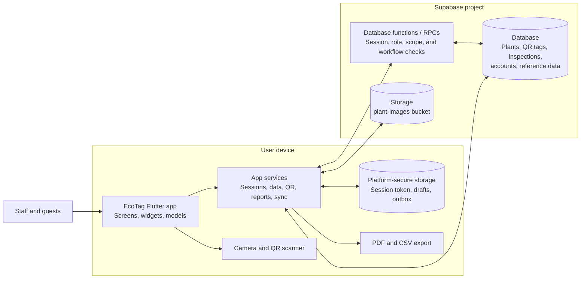
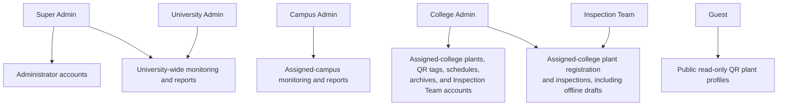
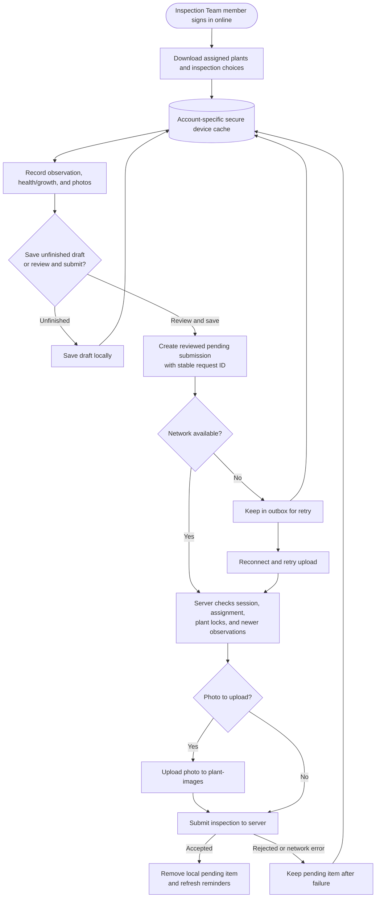

# EcoTag system diagrams

These diagrams summarize the current Flutter client, Supabase services, user
scopes, and inspection workflow. They are maintained as Mermaid source so they
can be viewed in GitHub and other Mermaid-compatible Markdown viewers.

## System architecture

The mobile/web client is not the authorization boundary: database functions
validate active staff sessions, role, and assignment scope. Guest access uses
separate public read-only workflows. Device storage holds account-specific
inspection work for later synchronization; it is not a replacement for the
server record.

## Roles and system capabilities

Staff access is restricted to the university, campus, or college scope assigned
to the account. The server rechecks that scope for protected operations.

## Inspection and offline synchronization

Offline work is available only after an online sign-in and while the signed-in
session is established. Unreviewed drafts are not uploaded. Failed pending
submissions remain on the device for retry; the server validates them again
when they reconnect.
